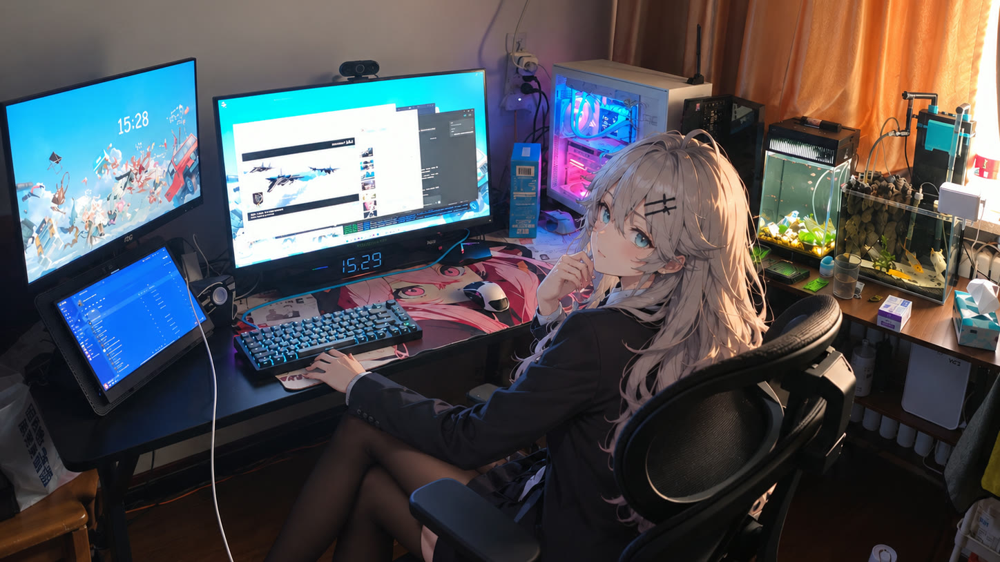
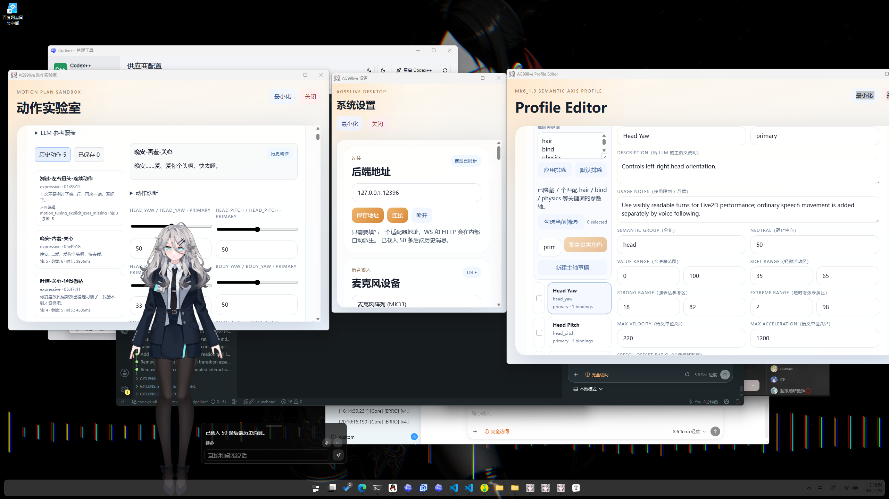
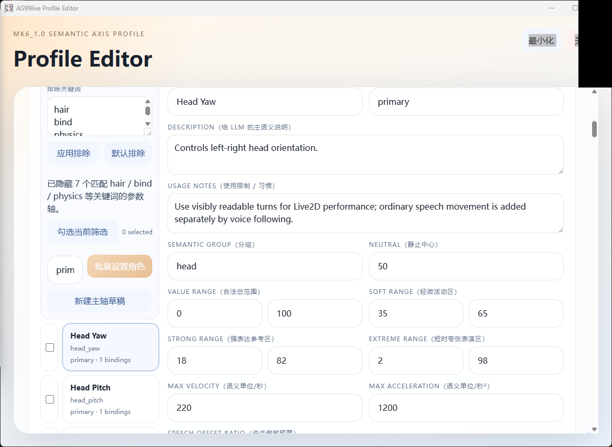

# AG99live

**让 AG99 在桌面上成为可见、可听、会回应的 Live2D 角色。**

AG99live 是 AG99 的桌面表现端：加载 Live2D 模型，播放语音，并同步字幕与动作；对话、人设和模型调用由 [AG99](https://github.com/murphys7017/AG99) 提供。

Windows · Electron · Live2D Cubism · Spout2

[下载桌面版](https://github.com/murphys7017/AG99live/releases) · [快速开始](#快速开始) · [功能介绍](#体验亮点) · [OBS 设置](#在-obs-中使用) · [开发文档](docs/README.md)

## 体验亮点

### 聊天时，角色会跟着回复一起表现

语音播放时，Live2D 角色可以同步做口型、转头、视线和姿态变化。动作可按回复分段关联，让长回复也能边说边表现，而不是等语音播完再统一摆一个姿势。每个模型通过自己的 Profile 映射动作，不必为每个模型重写一套动作语义。

动作表现会沿着同一条回复时间线进入：Persona 或动作 Provider 先产生语义动作，桌面端再进行动作预算、重复方向抑制、段间连续性衔接和抢占释放。动作迟到时只在有限尾部窗口内接管，过期结果会被丢弃，不重播已经完成的语音。当前重点仍是通过真实 AG99、TTS、Electron 和 Live2D 运行观察首帧延迟、段间余势与打断收势。

### 没有新消息时，也有基础的待机表现

桌面端提供可配置的待机动作、呼吸、眨眼、鼠标凝视和思考随动。这些本地表现不需要为每次眨眼或光标移动调用大模型；实际效果取决于设置和 Live2D 模型是否提供相应参数。

### 回复还在生成，角色可以先有反应

可选的轻量预动作在有效语音转写后提前请求一个简短反应；正式回复开始后，再由实际动作平滑接管。增量流式路径也可以逐步交付文本、音频和动作，让即时回复不必等整段内容全部完成。预动作、流式播放和真实设备间的完整效果仍需现场验收；当前增量流式覆盖即时回复，委派任务的最终结果仍走完整交付。细节见[流式实施计划](docs/02-设计文档/12-OLV全生命周期流式实施计划.md)与[轻量预动作说明](docs/02-设计文档/14-轻量预动作Prompt与接入.md)。

### 桌面互动遵循对话优先

可选的桌面观察只用数学方法判断画面是否发生大范围变化，不做 OCR、不分析画面内容，也不把截图发给模型。返回互动依据 Windows 锁屏/休眠与输入恢复形成机会。两项功能默认关闭；事件交给 AG99 的主动策略决定是否回应，不保证每次都说话，实机误报、漏报和语音表现仍待验收。规则见[桌面变化观察计划](docs/desktop-observation-plan.md)和[返回电脑互动计划](docs/desktop-return-plan.md)。

### 从桌面表演延伸到直播和外设

Spout2 可把透明 Live2D 画面交给 OBS。桌面端也能把 Bilibili 弹幕按设置合并后送入 AG99；需要小屏展示时，可将桌宠头部画面裁切并推送到 ESP32。弹幕接入不是完整的直播演出调度；ESP32 输出需要兼容设备并单独配置。

## 和 AG99 生态协作

AG99 管理对话、人设、记忆、工具和主动策略；AG99live 负责桌面输入、即时反应、Live2D 表现、音频播放和设备连接。两者协作复用同一条回复和播放链路，不各自维护一套会话或动作播放器。

安装 NeuroBrain 后，按 Persona 分段生成的动作可以读取当前情绪与行为状态，作为动作选择的辅助信息；它不是动作命令，也不是基础对话的依赖。后台被动动作属于实验功能，默认关闭。

Profile Editor 用于校准不同 Live2D 模型，Motion Lab 用于检查动作从输入到执行的过程。仓库还附有独立的 VTube Studio 数据录制工具，供开发者采集和检查原始参数；它不控制 VTube Studio，也不参与桌宠的实时动作播放。

## 界面预览

## 工作方式

AG99 负责对话与语音生成，Adapter 把回复交给桌面端。AG99live 在同一播放时间线上协调音频、字幕和动作，再由 Live2D runtime 渲染角色。

~~~text
用户输入
  -> AG99：生成对话与 TTS
  -> Adapter：接收回复，并校验 Persona 或独立 Provider 生成的动作
  -> 播放引擎：同步语音、字幕与动作
  -> Live2D 画面 -> 可选 Spout2 / OBS
~~~

完整协议、动作生成和播放时序见[文档中心](docs/README.md)。

当前动作表现链路、资源边界和后续优化优先级见[当前实现与交互表现基线](docs/01-架构与结构/10-当前实现与交互表现基线.md)。

## 快速开始

### 前置条件

- Windows 10 或 11。
- 已运行并配置好对话模型与 TTS 的 AG99 环境。
- 与当前 Live2D runtime 兼容的模型。
- Node.js 20 或更高版本仅在从源码运行桌面端时需要。

### 使用发布版

1. 从 [GitHub Releases](https://github.com/murphys7017/AG99live/releases) 下载并安装 AG99live 桌面版。
2. 从本仓库或配套源码包取得 <code>astrbot_plugin_ag99live_adapter/</code>，复制到 AG99 的插件目录，并使用 AG99 的 Python 环境安装该插件的 <code>requirements.txt</code>。
3. 启动 AG99，在插件管理中启用 **AG99live Adapter**。
4. 启动 AG99live，在设置中连接 Adapter、同步模型并选择要使用的 Live2D 模型。

Adapter 默认只监听本机回环地址：

| 服务 | 默认地址 | 用途 |
| --- | --- | --- |
| WebSocket | <code>ws://127.0.0.1:12396</code> | 桌面端与 AG99 之间的输入、回复和控制消息 |
| HTTP | <code>http://127.0.0.1:12397</code> | 模型、图片和缓存媒体 |

Adapter 运行设置可在 AG99 WebUI 的 **AG99live 控制台**管理；麦克风、快捷键和设备等本机设置由桌面端管理。登录仍由 AG99 处理。

### 从源码运行

~~~powershell
cd frontend
npm install
npm run dev
~~~

开发桌面端仍需安装并启用 AG99live Adapter。首次启动后，在桌面设置中连接 Adapter 并选择 Live2D 模型。

## 在 OBS 中使用

1. 启动 AG99live。
2. 在 OBS 添加 **Spout2 Capture**，选择 <code>AG99live.Live2D</code>。
3. 使用**预乘 Alpha**合成模式。

如果 Spout2 Sender 无法启动，桌面端仍可运行，但不会提供 Spout 输出。自行构建 Sender 时，在 Windows 安装 Visual Studio Build Tools（MSVC x64），然后运行：

~~~powershell
cd frontend
npm run build:spout-sender
~~~

## 开发与状态

从仓库根目录运行协议检查，再检查前端类型：

~~~powershell
python scripts/check_protocol_schema_manifest.py
cd frontend
npm run typecheck
~~~

这些检查不替代 AG99、TTS、桌面端、声卡和 Live2D 的完整联机验收。当前实现范围与待验收项目见[当前状态与验收边界](docs/01-架构与结构/06-当前状态与验收边界.md)。

## 第三方资源

仓库中的 Live2D 模型、贴图、动作、预览图和第三方 SDK 可能采用不同许可。使用或再分发前，请检查对应资源目录中的授权文件。
