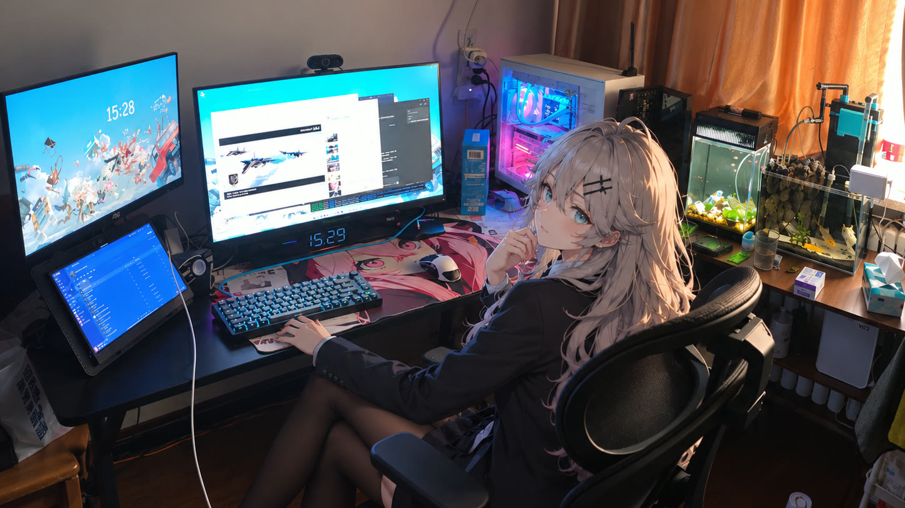
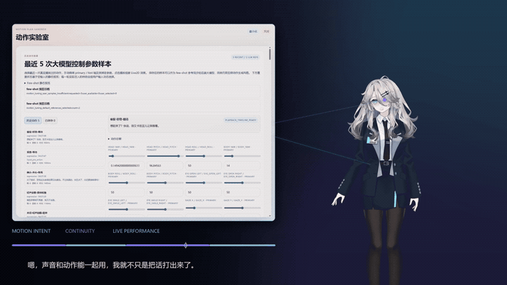
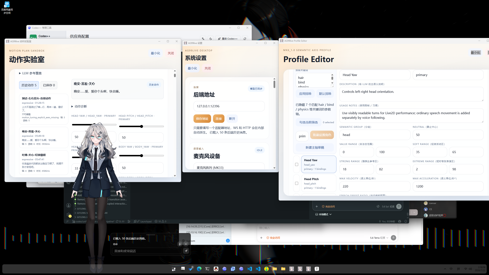
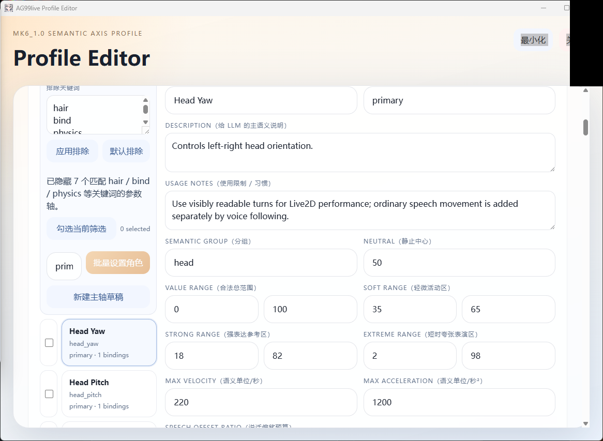

<div align="center">

# AG99live

### 点燃自己的历史。

**让 AI 不只是说话，也能通过表情、动作与陪伴回应你。**

一个基于 **Live2D** 的开源 AI 虚拟陪伴桌宠项目。  
以 **实时语义动作生成** 为核心，结合角色状态、语音交互与开放插件生态，探索更自然、更有连续性的长期陪伴。

[**下载桌面版**](https://github.com/murphys7017/AG99live/releases) · [**观看演示**](https://space.bilibili.com/41761329/lists?sid=8438550) · [**动作模型**](https://huggingface.co/AkiPolaris777/live2d-expression-model-gguf) · [**开发文档**](docs/README.md)

Windows · Live2D Cubism · AI Motion Generation · AstrBot Ecosystem



</div>

## 让虚拟角色真正参与交流

很多 AI 桌宠已经能够聊天、说话和播放 Live2D 动画，但角色的表现往往仍然依赖关键词、预设表情或固定动作。

**AG99live 想做得更进一步：让 AI 不仅决定“说什么”，也参与决定“怎样表达”。**

我们希望角色能够理解对话语义，结合当前交互与角色状态，实时组织表情、视线、头部姿态等动作；在一次次相处中，通过记忆和共同经历形成更连贯的陪伴体验。




> 上方为项目演示片段。完整演示请前往 [Bilibili](https://space.bilibili.com/41761329/lists?sid=8438550) 观看。动作生成的实际效果会随模型、配置和运行环境有所不同。

## 核心特色

### 01 · AI 实时生成 Live2D 动作

**不再只是“识别关键词 → 播放固定动画”。**

AG99live 将角色行为分成两个相互协作的部分：

- **语义动作生成**：大语言模型或专门训练的轻量模型，根据对话内容、上下文和可用的角色状态生成动作意图。
- **动作执行与表现**：AG99live 根据 Live2D Profile 将语义动作映射到模型参数，完成校验、限幅、连续衔接与播放。

因此，角色可以根据交流内容动态组合表情、视线、姿态等表现，而不必只在几段提前制作的动画之间切换。长回复也可以按语音片段逐步呈现动作，让角色在说话的同时表达。

这也是我们持续投入最多精力的方向：**让动作符合语义、随交流自然变化，并保持连续性。**

### 02 · 专为动作生成训练的轻量模型

为了让语义动作生成更适合实时交互，我们训练了面向 Live2D 表现的轻量语言模型。它生成结构化动作意图，具体参数映射与实时播放仍由 AG99live 的动作系统负责。

**当前公开模型：** [Live2D Expression Model — GGUF](https://huggingface.co/AkiPolaris777/live2d-expression-model-gguf)

模型作为可选的动作生成能力接入。模型文件、量化规格与推理配置请以 Hugging Face 仓库说明为准。

### 03 · 有连续状态的角色表现

角色不应该只在收到消息的一瞬间“活过来”。

AG99live 提供呼吸、眨眼、待机动作、鼠标凝视和思考随动等本地表现，同时探索让对话动作参考角色状态、交互上下文与情绪信息。

这些基础行为不需要每一次都调用大模型；而在真正交流时，状态信息又可以参与更复杂的动作决策。

我们想实现的不是持续不断的夸张动作，而是**在不同情境下有节奏、有连贯性的表达**。

### 04 · 更接近自然对话的实时响应

对于桌面陪伴，等待时间和表达时序同样重要。即使模型回答得很好，如果声音、字幕与动作各自滞后，互动也会显得生硬。

AG99live 围绕实时体验设计了流式回复、分段语音播放、字幕与动作同步、轻量预反应以及交互打断处理等机制。目标是让角色尽早给出反馈，并在整个回答过程中保持可见、可听的连续表现。

实际延迟会受后端模型、TTS、设备与网络等因素影响。

### 05 · 长期记忆与共同经历

**陪伴不只是连续聊天，更是能够记得过去。**

AG99live 起源于 AstrBot 插件生态，可以与长期记忆、自学习、知识库等社区插件协同工作，让角色在后续交流中参考过去的对话与共同经历。

这些能力并非全部由 AG99live 自己实现：后端与插件提供记忆、学习和工具能力，AG99live 则专注于把交流内容转化为自然的语音与角色表现。

我们希望这些逐渐积累的经历，最终能让每个人的虚拟伙伴拥有不同的互动历史。

### 06 · 主动互动，而不只是等待消息

除用户主动发起的对话外，AG99live 也在探索基于桌面事件的互动机会，例如用户返回电脑、桌面活动出现变化时，让后端策略判断是否适合回应。

这类机制以**避免打扰、尊重对话节奏**为前提，而不是每检测到一次变化就强制让角色说话。相关能力属于可选或持续实验的功能。

## 开放生态：AG99live × AG99 × AstrBot

AG99live 最初从 AstrBot 插件发展而来，并保持与兼容的 AstrBot 环境及社区插件协作的设计。

为了进一步优化响应速度、流式处理和桌面交互，我们还开发了配套后端 **[AG99](https://github.com/murphys7017/AG99)**：它基于 AstrBot 源码修改扩展，保留插件兼容方向，并针对 AG99live 的实时交互需求进行优化。

| 组件 | 主要职责 |
| --- | --- |
| **AG99live** | Live2D 渲染、语音与字幕播放、动作生成链路、桌面互动和设备连接 |
| **[AG99](https://github.com/murphys7017/AG99)** | 对话、人设、模型调用、插件、工具与实时消息协作 |
| **AstrBot 社区插件** | 根据需要扩展长期记忆、自学习、知识库等功能 |

AG99live 可以配合兼容的 AstrBot 后端使用。**若希望获得项目当前更完整的实时交互体验，推荐搭配 AG99。**

## 更多玩法

除了日常桌面陪伴，AG99live 还提供了面向创作与开发的扩展能力：

- **多 Live2D 模型适配**：通过 Profile Editor 配置和校准模型参数映射。
- **直播与录制**：借助 Spout2 向 OBS 输出透明 Live2D 画面；支持将 Bilibili 弹幕接入后端交互链路。
- **动作实验**：使用 Motion Lab 检查和调试语义动作从生成到执行的过程。
- **外部显示**：探索将角色画面输出到 ESP32 等兼容设备。

不同功能可能需要单独安装或配置，详情参阅 [项目文档](docs/README.md)。

## 界面预览

**桌面交互界面**



**Live2D Profile Editor**



更多动态效果：[查看 Bilibili 实机演示](https://space.bilibili.com/41761329/lists?sid=8438550)。

## 快速开始

AG99live 当前主要面向 **Windows 10 / 11**。你还需要一个已配置对话模型与 TTS 的 AG99 或兼容 AstrBot 后端，以及适配当前 runtime 的 Live2D 模型。

1. 从 [GitHub](https://github.com/murphys7017/AG99live) 下载 AG99live 源码。
2. 将仓库中的 `astrbot_plugin_ag99live_adapter/` 安装到后端插件目录，并在后端的 Python 环境中安装该插件 `requirements.txt` 所列的依赖。
3. 启动 AG99 / AstrBot，启用 **AG99live Adapter**。
4. 进入`frontend`文件夹运行命令`npm run dev`启动 AG99live，在设置中连接 Adapter，同步并选择 Live2D 模型。(目前是这样，程序包正在开发优化中)
5. 配置语音、动作模型或其他可选插件，开始与角色交流。

Adapter 默认监听本机回环地址：

| 服务 | 地址 | 用途 |
| --- | --- | --- |
| WebSocket | `ws://127.0.0.1:12396` | 交互消息与控制 |
| HTTP | `http://127.0.0.1:12397` | 模型与媒体资源 |

### 从源码运行

从仓库根目录执行（需要 Node.js 20 或更高版本）：

```powershell
cd frontend
npm install
npm run dev
```

桌面端启动后仍需要连接正在运行的 Adapter。更多配置与开发说明见 [文档中心](docs/README.md)。

### OBS 透明画面输出

在 OBS 中添加 **Spout2 Capture**，选择 `AG99live.Live2D`，并使用**预乘 Alpha**合成模式。若 Spout2 Sender 未成功启动，桌面端仍可独立运行，但不会输出 Spout 画面。

## 开发进展

AG99live 正在推进首个正式版本的收尾工作。当前关注的重点包括：

- 让实时生成的动作更符合语义，减少重复和突兀切换。
- 优化语音、字幕与动作的时序衔接和交互延迟。
- 完善状态系统、主动互动与不同 Live2D 模型的适配。

**下一阶段，我们计划探索基于 C++ 的高性能实现**，以降低当前桌面运行环境的资源占用，并改善渲染与交互效率。这属于后续方向，并非现有版本已完成的功能。

## 名字的由来

**AG99** 的名称灵感来自 SCP 基金会中文分部作品 [《SCP-CN-1559 — 青鸟》](https://scp-wiki-cn.wikidot.com/scp-cn-1559) 中的 **AG-99（异学九十九）** 相关设定。

> 点燃自己的历史。

我们以这句话表达项目的愿景：一个虚拟伙伴不应只有当前这一次回答，也应该能够借由持续的交流与共同经历，逐渐积累属于彼此的历史。

我们想做的，不只是一个“会聊天的 Live2D”，而是一个**能够用自己的方式表达、并陪伴你经历时间的虚拟角色**。

## 相关项目与资源

- [AG99 — 配套 AI 后端](https://github.com/murphys7017/AG99)
- [AstrBot — 开源智能体与插件生态](https://github.com/AstrBotDevs/AstrBot)
- [Live2D Expression Model — GGUF](https://huggingface.co/AkiPolaris777/live2d-expression-model-gguf)
- [AG99live 开发文档](docs/README.md)
- [AG99live Bilibili 演示](https://space.bilibili.com/41761329/lists?sid=8438550)

## 资源与许可

仓库中的 Live2D 模型、贴图、动作、预览素材及第三方 SDK 可能分别适用不同许可。使用或再分发前，请检查各资源的授权文件。SCP-CN-1559 为第三方创作作品，项目命名灵感不代表与原作者或 SCP 基金会存在官方关联。

---

<div align="center">

**AG99live · 点燃自己的历史**

*让 AI 不止于对话。*

</div>
