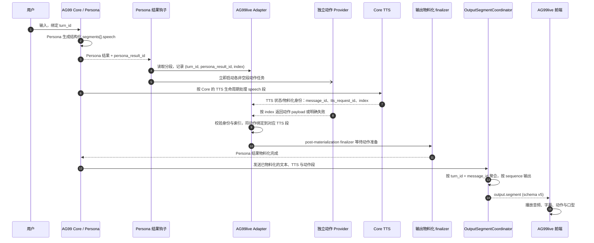

# 动作生成与 Persona 分段关联

本文说明 Adapter 当前三种动作生成模式，以及启用 Persona speech 分段时，动作、TTS 与输出段如何关联。配置字段以 `astrbot_plugin_ag99live_adapter/_conf_schema.json` 为准；钩子与生命周期以 Adapter 和配套 AG99 Core 的实际实现为准。

## 三种动作路径

| 配置 | 文本与动作来源 | 动作粒度 | 行为 |
| --- | --- | --- | --- |
| `independent_motion.enabled=false` | Persona 回复及 `ag99live.motion` Persona Effect | 每个 Persona 回复段 | 主 Persona 输出带结构化 Effect；Adapter 校验并将动作归到对应 Persona 段。此时才注册 AG99live 的 Persona Effect。 |
| `enabled=true`, `per_speech_segment=false` | Persona 回复 + 独立动作 Provider | 整条回复 | 使用专用 Provider 生成一次动作；按回复阶段和可见文本匹配结果。Persona Effect 路径关闭。 |
| `enabled=true`, `per_speech_segment=true` | Persona 结构化 speech 分段 + 独立动作 Provider | 每个非空 speech 段 | Persona 仍生成并交付回复分段；Adapter 为每段调用专用 Provider，匹配动作到相同索引的 TTS/输出段。Persona Effect 路径关闭。 |

`parallel` 在整条回复模式中表示 Provider 与回复文本生成并行；分段模式中表示 Persona 结果到达后，各段动作 Provider 并发运行。分段模式关闭 `parallel` 时按段串行请求。并发数由 `max_concurrency` 限制（默认 4，最大 8）。`segment_timeout_seconds` 是单段动作请求上限（默认 5 秒，最大 60 秒；0 不限制），最终 Core 汇合仍受 30 秒上限约束。

## 分段模式时序

Persona 同段 `actions` 表示可同时发生的动作。需要先后配合话语的动作应由 Persona
拆成不同 `segments`，如“左……”绑定左转头、“右……”绑定右转头；每段的心理想法与
情绪仍完整生成。结构校验只能检查字段，不保证模型正确理解分段语义。

Electron 按原段序播放，并等待本段语音和动作都进入终态后才开始下一段；不跳过
语音已结束但动作仍在执行的段。动作与 TTS 的生成、网络投递可以提前并行，准备完成
不意味着立即执行。无动作或动作明确失败的段仍按已有终态规则继续。

图中动作生成与 TTS 的启动可以重叠；图不表示两者必须同步开始或按返回先后排序。`index` 是 Persona 结果内的稳定段序号，因此动作 Provider 的完成顺序不决定播放顺序。Core 仍拥有 TTS 合成和消息物料化；Adapter 不接管 TTS。

## 身份与汇合

- `turn_id` 隔离一次对话以及其动作任务的取消范围。
- `persona_result_id` 区分同一 Turn 内不同 Persona 结果/阶段，避免即时结果和最终结果串线。
- `persona_segment_index` 与 `persona_segment_count` 表示 Persona speech 段在该结果中的位置和总数。
- Core 的 TTS 回调再提供 `message_id`、`tts_request_id` 和父消息关联；Adapter 验证它们与 Turn、Persona 结果及索引一致后建立绑定。
- 输出协议中的 `message_id` 标识实际逻辑消息，`sequence` 决定 Turn 内播放顺序；前端 `segment_id` 和动作 `run_id` 是后续播放层身份，不替代上述关联键。

空 speech 段不请求动作，并在输出侧标记为不安排动作。非法、冲突或缺失身份不会猜测索引或绑定到“当前段”。

## 延迟、失败与取消

分段动作任务在 Persona 结果回调中启动，不等待 TTS 文本物料化；Core 的 TTS 继续自行合成，因此两项工作通常能并行。TTS 请求身份到达后 Adapter 完成段级绑定。Persona 结果物料化时，Core 调用 post-materialization finalizer 等待动作任务；Core 按分段数、配置的单段超时计算等待时限，并将总时限封顶 30 秒。finalizer 返回的动作贡献随后参与 Persona 输出交付和 Adapter 原子段聚合。

独立 Provider 超时、返回空内容、JSON 解析失败或动作校验失败，只影响对应动作结果；分段文本和索引仍保留，段动作按明确失败状态处理，不会挪用其他段动作。Turn 中断会停止/丢弃该 Turn 的在飞生成任务，迟到结果不能重新绑定到后续 Turn。是否满足目标环境中的延迟和恢复体验仍需使用真实 Core、Provider、TTS 和桌面端验收。

动作生成缺失的失败原因统一为 `motion_schedule_failed:<原因>`。Core 双输出的无索引 Plain
回声不再重复写入动作期望或动作失败状态；同一逻辑段的动作状态由带 Persona 索引的
TTS 投递负责。动作失败仍以 `motion.state=failed` 随文本、音频一起提交原子段，前端不播放
该段语义动作，但继续消费文本与音频。身份、段数冲突以及动作成功与失败相互覆盖仍被拒绝；
不会把失败伪装为默认动作成功。

## 与 speech cues 的区别

Persona `segments[].speech` 是回复文本和 TTS 的分段输入；它不是 WebSocket `output.segment.payload.speech` 中的 speech cues。协议仍定义可选 speech cues，但当前 Adapter 输出会把该 slot 写为 `absent`。不要把 Persona 分段存在误读成前端收到 speech cues，也不要以旧 `speech_cues` 字段是否存在判断分段动作是否工作。

## 排障观察点

优先按同一个 `turn_id` 检查 `persona_result_id`，再核对 `persona_segment_index/count`、TTS 的 `message_id/tts_request_id`、动作生成完成原因、finalizer 结果及最终输出的 `sequence`。缺少前端动作时，要区分未启用分段模式、该 speech 为空、Provider 未配置、生成/校验失败、身份绑定失败、Turn 已取消和前端动作编译失败。
