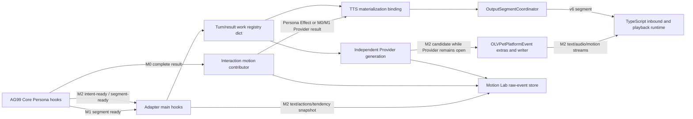

# Persona 动作生命周期阶段 0 基线与当前复核

历史基线：2026-10-24。当前源码复核：2026-10-28。

本文保留 10 月 24 日记录的冻结快照，供理解重构前状态；它不是当前代码描述。最新实现进度见本节，之后的历史表格和调用链均按 10 月 24 日状态阅读。当前复核以源码为依据，尚未做目标环境实时验收。

## 2026-10-28 当前状态增量

| 事实/组件 | 当前源码事实 | 对计划的影响 |
| --- | --- | --- |
| 身份对象 | PersonaTurnIdentity、PersonaSegmentIdentity 已用于 Registry、段 admission 和 TTS binding。Registry 以 Core Turn ID 索引；frontend Turn ID 仍由输出协调器和 M2 writer 持有。 | 阶段 2 身份迁移完成；终止 hook 通过 TurnCoordinator 映射校验 frontend/Core 绑定。 |
| Turn/Result/Segment 状态 | PersonaTurnSessionRegistry 管理 Turn session、result、segment、任务登记、writer 和取消；Result 保存 Core stream 终态，Segment 保存内容、意图、Provider Future 和 TTS binding。 | 阶段 3 收口了生命周期状态；清理后的 Turn ID 与 Result ID 在保留窗口内拒绝重建。 |
| 段流装配 | `PersonaResultState.delivery_assembly` 是类型化汇总状态，保存已交付索引、模板、streaming 标记和 delivery completion latch；段数由 Result 的 `expected_segment_count` 持有，terminal status 仅在 `stream_status`。 | Core stream terminal 与输出完成可乱序到达；两者都到达后校验覆盖并清理装配索引和模板。 |
| M0/M1 wire | 完整段由 OutputSegmentCoordinator 负责物料化和 v6 输出；Persona Result 只保留关联索引与 TTS binding。 | wire 状态由 OutputSegmentCoordinator 持有，不进入 Persona Result 的 stream terminal。 |
| M2 wire | `IncrementalOutputSession` 持有 motion payload 去重、revision、提前到达暂存和 resource terminal；平台事件只提交 motion result fact。 | M2 motion wire 状态不再镜像到 PersonaSegmentState 或平台事件。 |
| 动作结果 | Persona Effect 与独立 Provider 共用段身份；Provider 最终结果仅通过 `result_future` 交接，任务负责产生结果。 | Result terminal 会取消未完成 Provider 任务和 Future；迟到结果不会更新 Future 或投递 motion。 |
| Motion Lab | Adapter 写入 motion.persona_sample.v1 快照；tools/persona_motion_dataset.py 按 sample_id 离线归并，区分采集闭合和质量状态，关联播放证据，保留 malformed 事件与字段冲突诊断；审核后仅导出 closed 样本。 | 阶段 5 源码实施与复核完成；raw-event schema v3 和 training schema v1 未变，真实采集验收待阶段 6。 |
| 客户端执行 | 桌面端记录 playback started/completed/failed 等事实；Adapter 发送成功本身不代表播放或 Live2D 执行成功。 | 客户端执行轨道与 Provider、wire 轨道分开。 |
| 路由固定 | OLV 事件创建时固定动作来源路由，后续 M1 分段、结果调度和 M0/M1 TTS 身份采集沿用该路由。 | 该竞态修复已完成，不列入待办。 |
| 本地验证与实时验收 | Python compileall、三个 CLI help、state YAML parse 与 `git diff --check` 通过；未运行测试或读取真实 Motion Lab 数据库。目标 AstrBot/Core、Provider、TTS、桌面和 Live2D 尚未联合运行。 | 阶段 1-5 源码实施/复核完成；阶段 6 的目标环境验收仍未完成。 |

当前简化调用链：

~~~mermaid
flowchart LR
  Core[Core Persona hooks] --> Main[Adapter hooks]
  Main --> Registry[PersonaTurnSessionRegistry]
  Registry --> Schedule[动作调度与 Provider]
  Registry --> Binding[TTS binding]
  Schedule --> V6[OutputSegmentCoordinator / v6]
  Schedule --> OLV[OLV writer / M2]
  V6 --> Client[桌面接收与播放]
  OLV --> Client
  Main --> Recorder[Motion Lab raw-event recorder]
  Schedule --> Recorder
  V6 --> Recorder
  Recorder --> Reducer[离线 sample_id reducer / review / export]
~~~

以上图示描述主要边界，不代表所有数据都由 Registry 直接经过每个节点；字段所有权与目标规则见下方矩阵。

## 2026-10-28 事实所有权与转移矩阵（目标契约）

本矩阵区分事实来源、Adapter 内的关联/协作状态和协议侧权威状态。表中“Adapter 当前状态”描述源码复核发现；转移约束描述本次重构要落实的目标规则，不代表现有实现均已满足。Adapter 的观测副本用于关联与诊断，不得反向覆盖事实来源。

| 事实轨道 | 事实来源 / 唯一权威所有者 | Adapter 当前状态与目标状态 | 目标转移、失败与清理规则 |
| --- | --- | --- | --- |
| Turn 身份与取消范围 | Core/TurnCoordinator 建立 Turn；PersonaTurnSessionRegistry 负责 Adapter 内会话和协作任务索引。 | Registry 以 `PersonaTurnIdentity.turn_id` 的 Core Turn ID 索引；frontend/Core 对应关系由 TurnCoordinator 校验。 | TurnCoordinator 发起取消；Registry 取消该 Turn 注册任务、清理会话，并在最近 256 个关闭 Turn 的保留窗口内拒绝迟到 admission。 |
| Persona result/segment 身份 | Core hooks 提供 result ID、segment index/count/message ID；Registry 校验并持有 Adapter 关联索引。 | result/segment map 仅作查找索引；Registry 段 admission 现要求 `PersonaSegmentIdentity`。 | 空/冲突身份和越界索引在 admission 处拒绝；仅契约明确幂等的完全相同事件可重复接受。 |
| Persona 内容与意图 | Core 的 Persona intent/segment-ready 事件是来源事实；Registry 保存已接收快照供调度与绑定消费。 | Result 的类型化入口校验终态后再绑定意图/内容；TTS 绑定可在 stream terminal 后、delivery completion 前补齐。 | 同一身份内容不一致时拒绝；Result terminal 后拒绝迟到意图/内容，delivery completion 后拒绝迟到 TTS binding。 |
| 独立 Provider 结果 | Provider generation task 返回 `IndependentMotionResult`；Provider 最终状态与候选事件由该任务产生。 | Segment 仅保存 `result_future` 等待句柄，不另存 Provider result 副本。 | 超时、Provider failure、取消保留各自原因；Result terminal 取消未决 Future 和 Provider 任务，迟到结果不能复活句柄或进入其他身份。 |
| Persona Effect 结果 | Core Effect hook 输入经 Adapter sanitizer/normalizer 形成接受或拒绝结果。 | 当前按 Effect 路径归一化，不产生独立 Provider 请求。 | 归一化失败属于 Effect 轨道失败，不映射为 Provider 失败或投递成功。 |
| TTS 身份绑定 | Core TTS materialization 提供 request/message 身份；Registry 的 segment binding 是 Adapter 关联绑定的权威副本。 | `PersonaTtsBinding` 持有完整 `PersonaSegmentIdentity`；传给输出协调器的是消费用快照。 | request、message、segment 身份冲突即拒绝；Result/Turn 清理仅释放关联，不改写 TTS 已发生事实。 |
| Core Persona 段流汇总 | Core segment hook 与 terminal hook 提供段索引及终态；Adapter 验证段数覆盖并协调与输出完成回调的先后。 | `PersonaResultState.delivery_assembly` 持有索引、模板和 completion latch；段数与 terminal status 只在 Result 状态。 | completed 要求完整索引；其他 Core 终态验证连续前缀。两个完成信号可乱序到达；两者都到达后清理索引和模板，保留最小闭合标记到 Result 清理。 |
| M0/M1 v6 wire | `OutputSegmentCoordinator` 负责 pending、序号分配、物料化、发送和发送失败。 | Persona identity 用于关联；v6 wire 真相留在 coordinator。 | 按既有队列顺序 flush；发送失败由 coordinator 记录，不改写 Persona/Provider 结果。 |
| M2 OLV wire | `IncrementalOutputSession` 是协议 stream、sequence、revision 和 end status 的权威所有者。 | Writer 也持有 per-segment motion payload、revision 和 pending fact；PersonaSegmentState 与平台事件不镜像 wire 状态。 | Writer 拒绝重复 start、非 open stream 的 update/end；stream 启动前最后一个 pending fact 由 writer 暂存并在 motion start 后发送；相同 payload 幂等，闭合后拒绝不同 revision。 |
| 客户端播放/Live2D 执行 | 桌面端 playback timeline / ModelEngine。 | Adapter 只将收到的客户端事件作为观测事实。 | 以客户端回执为准；Adapter send 成功、Provider 完成或 wire end 均不推断播放成功。 |
| Motion Lab 记录与样本投影 | Recorder 追加不可变 raw event；离线 reducer 负责样本投影和训练质量判断。 | Raw event 是证据；review sample 是可重建投影，不是运行时生命周期权威状态。Reducer 按 `sample_id` 归并，输出 collection/quality 状态、malformed 事件身份与字段冲突来源。 | 仅来源成功终态可闭合；失败、超时、明确取消和终态冲突为 incomplete。缺少终态事实保持 open，不能推断活动中或取消。Malformed 事件留在 raw store 并进入诊断；审核导出只接受 closed 且 quality reviewable 样本。M2 wire/桌面执行事实仍不由此推断。 |

关键转移约束：

- Turn/Result/Segment 的取消沿父级向下传播；子级失败保持 Core 文本/音频原有隔离语义。
- 超时是对应异步操作的终止原因，不自动等同于用户/Turn 取消。
- 已进入终态的 Result/Segment 不接受会改变身份、内容或终态的迟到事件；完全相同且契约幂等的重复事件可返回既有结果。
- `segment_count` 是 Persona 分段维度；v6 `sequence` 与 OLV resource `seq/revision` 各自属于对应输出协议。
- 样本的 `collection_status` 与 `quality.status` 分开：采集闭合必须有来源终止证据；`blocked/reviewable` 只表达训练审核门槛。

## 2026-10-24 冻结基线（历史快照）

## 字段所有权（2026-10-24 历史快照）

| 状态/身份 | 当前存储位置 | 写入方 | 读取/消费方 | 当前问题 |
| --- | --- | --- | --- | --- |
| `turn_id` 与 Core Turn 绑定 | TurnCoordinator、event extras、`PersonaStreamMotionRegistry` work | TurnCoordinator、Core hook | main hook、独立动作任务、OLV writer、输出协调器 | 字符串在边界间重复传递；校验散布在调用方。 |
| `persona_result_id`、phase、父消息身份 | registry work 字典、事件 metadata/extras | Core hooks、interaction result hook | main hooks、scheduling finalizer、平台事件 | 同一身份字段有多个来源；registry 当前按 Turn 持有一个流式 work。 |
| segment index/count、speech/actions/tendency | work 字典、`speech_segments`、`segment_intents_by_index`、Core result view | Persona intent/ready hooks、结果回调 | Provider 生成、TTS 绑定、样本记录 | 字段结构依靠字典约定；ready 前后字段分处不同容器。 |
| Provider request/result/preview/deadline/tasks | `independent.py` 局部变量和 registry work 字典 | interaction result/segment hooks、Provider 任务 | scheduling finalizer、Persona event hook | provider 状态与段交付状态没有共同对象。 |
| TTS/message binding | `_ag99live_persona_tts_segment_map` event extra、work 的 `tts_bindings_by_index` | scheduling hooks/materialization | finalizer、platform event、OutputSegmentCoordinator | 同一绑定在 event extra 与 work 中分别读写。 |
| OLV writer、pending/started/delivered/future | writer 对象、event extras、platform event 局部状态 | `OLVPetPlatformEvent`、Core segment hooks | text/audio/motion 发布与 flush | per-result bucket 与共享 extras fallback 并存；生命周期状态分散。 |
| 完整输出段、sequence、motion slot | OutputSegmentCoordinator 的 pending segment 与输出队列 | Core TTS/output callbacks、Adapter motion finalizer | WebSocket v6 下行 | Adapter 完整输出路径的权威交付所有者。 |
| Motion Lab 事实事件 | `motion.persona_sample.v1` raw-event SQLite 表 | observation helper、main hooks、motion hooks | Motion Lab 消费端 | 当前按事件追加快照；尚无 sample reducer 闭合终态。 |
| 客户端播放/动作执行 | TypeScript Turn session、Timeline runtime、ModelEngine | inbound event dispatch/playback runtime | 播放完成协调器与 UI | Adapter 只掌握发送结果，不拥有客户端执行终态。 |

## 调用链（2026-10-24 历史快照）

M0 is a completed Persona result followed by per-speech-segment motion generation and normal materialization. M1 receives Persona segments incrementally but binds them to complete v6 output. M2 opens the OLV writer and may publish a validated Provider preview before the Provider request reaches its final result. Persona Effect converts Effect arguments without an independent Provider request.

## 状态转移基线（2026-10-24 历史快照）

生成、绑定/投递和客户端执行是相关但并行的状态轨道。单个线性枚举会错误表达 M2 的早期候选投递，也会错误要求 Persona Effect 经过 Provider。

| 轨道 | 状态/转移 | 事实所有者 | 终态或约束 |
| --- | --- | --- | --- |
| 身份与内容 | `admitted -> segment_intent_ready -> segment_ready` | Core hook + Adapter admission | 身份冲突拒绝；M2 的动作请求可在 speech ready 前启动。 |
| 动作生成 | `not_requested -> effect_received -> normalized / failed` | Persona Effect path | Effect 路径没有 Provider 状态。 |
| 动作生成 | `requested -> candidate* -> normalized / failed / timed_out / cancelled` | independent Provider task | 候选可多次出现；Provider 终态不表示已发送或已执行。 |
| 绑定 | `unbound -> bound / binding_failed / not_applicable` | Persona/TTS materialization | M0/M1 按 Persona index 绑定 TTS；M2 在 segment stream 身份中绑定。 |
| 交付 | `not_started -> open -> update* -> ended / failed / cancelled` | v6 OutputSegmentCoordinator 或 M2 writer | M2 update 可早于 Provider 终态；v6 motion slot 可以 pending 后续补齐。 |
| 客户端执行 | `not_received -> accepted/running -> completed / failed / cancelled` | TypeScript playback/ModelEngine | 与 Adapter 的 wire 终态分开；由客户端回执/运行状态确认。 |
| 样本归约 | `facts* -> incomplete / complete / rejected` | 目标 Persona sample reducer | 必须保留各轨道身份与状态；Provider candidate 不等于 wire update。 |

## 变更量统计说明（历史门槛，已取消）

2026-10-28 修订计划已取消净删除行数要求：历史基线没有可复算的生产文件快照，行数也不能证明状态所有权或行为正确。以下段落只记录旧计划的统计设想。

本次工作区在阶段 0 开始前已经存在未提交的 Adapter、Motion Lab、Electron 和文档修改。因此，生产代码增删不能直接用当前分支相对 `HEAD` 的总差异计算。正式验收需要使用阶段 0 开始时保存的重构文件快照，按生产代码、测试代码和文档分别计算 `新增行数` 与 `删除行数`；若缺少该快照，只能报告当前工作区统计，不能宣称本次重构满足净删除门槛。

每个状态变更必须校验 `(turn_id, core_turn_id, persona_result_id, segment_index, segment_message_id)` 中当阶段已知的字段。`segment_count` 与普通输出 `sequence` 是不同维度。缺失事实应留空或标为 unavailable，不从后续结果反推模型当时的输入。

## 外部边界（2026-10-24 冻结记录）

- 不修改 `output.segment.v6`、`olv.incremental_output.v1` 或 Core Persona 输出结构。
- 保留 M0、M1、M2 的现有用户可见行为、超时边界、动作失败隔离、Turn 取消和输出顺序。
- 统一状态与样本 reducer 属于 Adapter 内部实现；Motion Lab 原始事件 schema v1 保持既有采集契约，SQLite v3 迁移只用于丢弃不兼容旧记录。
- 本阶段不实现前端执行状态回传，也不把 Adapter 的发送成功解释为 Live2D 执行成功。

## 风险清单（2026-10-24 历史快照）

1. `PersonaStreamMotionRegistry`、独立 Provider work、TTS binding、event extras 和 writer 分别拥有部分状态，清理操作必须保持取消语义。
2. OLV writer 的 per-result identity 与 event 上共享 extras 需要单一化，不能因一个 Turn 有多个 Persona result 而误投迟到动作。
3. M0/M1 的 Provider、TTS 与输出物料化并行；M2 的 Provider candidate、文本/音频流与动作流并行。重构不得引入不必要的串行等待。
4. raw-event 数据库 schema v3 和桌面待发送 IndexedDB 清理是当前未提交工作的一部分；不重置 tuning samples、VTube Studio 数据或聊天记录。
5. 真实 Core、Provider、TTS、Electron 和 Live2D 联合验收尚未完成；本地验证不能替代现场验收。
