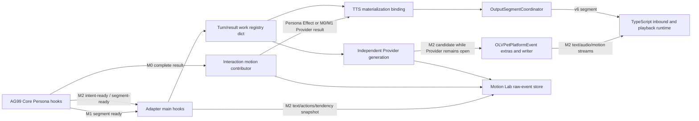

# Persona 动作生命周期阶段 0 基线

更新：2026-10-24。本文记录当前源码事实，作为统一生命周期重构的行为基线。它不描述目标实现，也不改变协议。

## 当前字段所有权

| 状态/身份 | 当前存储位置 | 写入方 | 读取/消费方 | 当前问题 |
| --- | --- | --- | --- | --- |
| `turn_id` 与 Core Turn 绑定 | TurnCoordinator、event extras、`PersonaStreamMotionRegistry` work | TurnCoordinator、Core hook | main hook、独立动作任务、OLV writer、输出协调器 | 字符串在边界间重复传递；校验散布在调用方。 |
| `persona_result_id`、phase、父消息身份 | registry work 字典、事件 metadata/extras | Core hooks、interaction result hook | main hooks、scheduling finalizer、平台事件 | 同一身份字段有多个来源；registry 当前按 Turn 持有一个流式 work。 |
| segment index/count、speech/actions/tendency | work 字典、`speech_segments`、`segment_intents_by_index`、Core result view | Persona intent/ready hooks、结果回调 | Provider 生成、TTS 绑定、样本记录 | 字段结构依靠字典约定；ready 前后字段分处不同容器。 |
| Provider request/result/preview/deadline/tasks | `independent.py` 局部变量和 registry work 字典 | interaction result/segment hooks、Provider 任务 | scheduling finalizer、Persona event hook | provider 状态与段交付状态没有共同对象。 |
| TTS/message binding | `_ag99live_persona_tts_segment_map` event extra、work 的 `tts_bindings_by_index` | scheduling hooks/materialization | finalizer、platform event、OutputSegmentCoordinator | 同一绑定在 event extra 与 work 中分别读写。 |
| OLV writer、pending/started/delivered/future | writer 对象、event extras、platform event 局部状态 | `OLVPetPlatformEvent`、Core segment hooks | text/audio/motion 发布与 flush | per-result bucket 与共享 extras fallback 并存；生命周期状态分散。 |
| 完整输出段、sequence、motion slot | OutputSegmentCoordinator 的 pending segment 与输出队列 | Core TTS/output callbacks、Adapter motion finalizer | WebSocket v6 下行 | Adapter 完整输出路径的权威交付所有者。 |
| Motion Lab 事实事件 | `motion.persona_sample.v1` raw-event SQLite 表 | observation helper、main hooks、motion hooks | Motion Lab 消费端 | 当前按事件追加快照；尚无 sample reducer 闭合终态。 |
| 客户端播放/动作执行 | TypeScript Turn session、Timeline runtime、ModelEngine | inbound event dispatch/playback runtime | 播放完成协调器与 UI | Adapter 只掌握发送结果，不拥有客户端执行终态。 |

## 当前调用链

M0 is a completed Persona result followed by per-speech-segment motion generation and normal materialization. M1 receives Persona segments incrementally but binds them to complete v6 output. M2 opens the OLV writer and may publish a validated Provider preview before the Provider request reaches its final result. Persona Effect converts Effect arguments without an independent Provider request.

## 状态转移基线

## 变更量统计基线

本次工作区在阶段 0 开始前已经存在未提交的 Adapter、Motion Lab、Electron 和文档修改。因此，生产代码增删不能直接用当前分支相对 `HEAD` 的总差异计算。正式验收需要使用阶段 0 开始时保存的重构文件快照，按生产代码、测试代码和文档分别计算 `新增行数` 与 `删除行数`；若缺少该快照，只能报告当前工作区统计，不能宣称本次重构满足净删除门槛。

生成、绑定/投递和客户端执行是相关但并行的状态轨道。单个线性枚举会错误表达 M2 的早期候选投递，也会错误要求 Persona Effect 经过 Provider。

| 轨道 | 状态/转移 | 事实所有者 | 终态或约束 |
| --- | --- | --- | --- |
| 身份与内容 | `admitted -> segment_intent_ready -> segment_ready` | Core hook + Adapter admission | 身份冲突拒绝；M2 的动作请求可在 speech ready 前启动。 |
| 动作生成 | `not_requested -> effect_received -> normalized / failed` | Persona Effect path | Effect 路径没有 Provider 状态。 |
| 动作生成 | `requested -> candidate* -> normalized / failed / timed_out / cancelled` | independent Provider task | 候选可多次出现；Provider 终态不表示已发送或已执行。 |
| 绑定 | `unbound -> bound / binding_failed / not_applicable` | Persona/TTS materialization | M0/M1 按 Persona index 绑定 TTS；M2 在 segment stream 身份中绑定。 |
| 交付 | `not_started -> open -> update* -> ended / failed / cancelled` | v6 OutputSegmentCoordinator 或 M2 writer | M2 update 可早于 Provider 终态；v6 motion slot 可以 pending 后续补齐。 |
| 客户端执行 | `not_received -> accepted/running -> completed / failed / cancelled` | TypeScript playback/ModelEngine | 与 Adapter 的 wire 终态分开；由客户端回执/运行状态确认。 |
| 样本归约 | `facts* -> incomplete / complete / rejected` | 目标 Persona sample reducer | 必须保留各轨道身份与状态；Provider candidate 不等于 wire update。 |

每个状态变更必须校验 `(turn_id, core_turn_id, persona_result_id, segment_index, segment_message_id)` 中当阶段已知的字段。`segment_count` 与普通输出 `sequence` 是不同维度。缺失事实应留空或标为 unavailable，不从后续结果反推模型当时的输入。

## 冻结的外部边界

- 不修改 `output.segment.v6`、`olv.incremental_output.v1` 或 Core Persona 输出结构。
- 保留 M0、M1、M2 的现有用户可见行为、超时边界、动作失败隔离、Turn 取消和输出顺序。
- 统一状态与样本 reducer 属于 Adapter 内部实现；Motion Lab 原始事件 schema v1 保持既有采集契约，SQLite v3 迁移只用于丢弃不兼容旧记录。
- 本阶段不实现前端执行状态回传，也不把 Adapter 的发送成功解释为 Live2D 执行成功。

## 当前风险清单

1. `PersonaStreamMotionRegistry`、独立 Provider work、TTS binding、event extras 和 writer 分别拥有部分状态，清理操作必须保持取消语义。
2. OLV writer 的 per-result identity 与 event 上共享 extras 需要单一化，不能因一个 Turn 有多个 Persona result 而误投迟到动作。
3. M0/M1 的 Provider、TTS 与输出物料化并行；M2 的 Provider candidate、文本/音频流与动作流并行。重构不得引入不必要的串行等待。
4. raw-event 数据库 schema v3 和桌面待发送 IndexedDB 清理是当前未提交工作的一部分；不重置 tuning samples、VTube Studio 数据或聊天记录。
5. 真实 Core、Provider、TTS、Electron 和 Live2D 联合验收尚未完成；本地验证不能替代现场验收。
