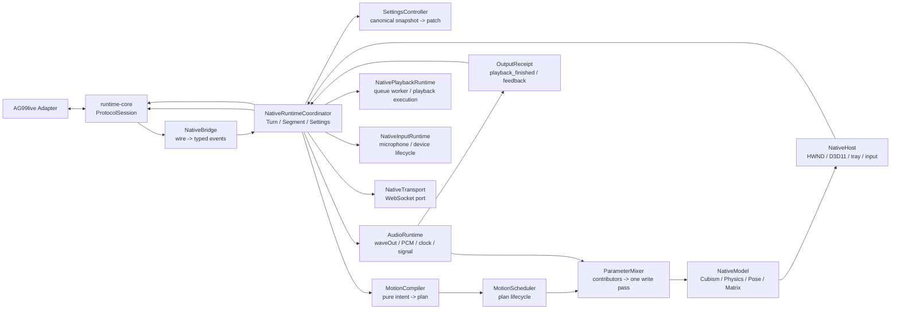

# C++ Native Runtime 整体架构重设计

状态：Phase 1-4 源码迁移完成，Native 播放/输入边界已收口，Phase 5 真实验收待完成 · 2026-11-13
范围：`render-core/` 与 `runtime-core/` 的 Native 运行时结构，不改变 AG99live V1 协议和 TS 桌面职责

当前实施进度：Phase 1-4 的源码迁移已完成，Phase 5 进入验收收口。
`SettingsController` 现在拥有 Native 设置的解析、范围和 canonical snapshot；
`NativeRuntimeCoordinator` 通过 `RuntimeCoordinatorCallbacks` 与
`RuntimeCoordinatorServices` 接收宿主能力。麦克风 WinMM 采集和 PCM 上行由
`NativeInputRuntime`/`MicrophoneCapture` 持有；完整 WAV/OLV PCM 的两个 WinMM 播放器
和音频设备边界由 `AudioRuntime` 持有。播放队列消费、
增量 PCM worker 和播放时钟编排由 `NativePlaybackRuntime` 持有；麦克风采集与设备
生命周期由 `NativeInputRuntime` 持有；底层 WebSocket 客户端由 `NativeTransport`
封装。`AudioRuntime` 只持有播放设备、音频时钟、信号和 opaque work queue。Turn、
Segment、OLV、音频时钟编排和唯一 receipt 状态机的数据 ledger 已移入
`playback_ledger.hpp`，协调器实现位于 `native_runtime_coordinator.cpp`。
音频时钟、RMS、speech signal 和播放生命周期现在由 `AudioRuntime` 持有，
协调器只通过 `RuntimeCoordinatorServices` 使用它们。
PCM 队列、增量音频队列、playback ack 队列和当前音频 identity 也由
`AudioRuntime::AudioQueueState` 持有；协调器只驱动队列状态机。
当前实现通过 `AudioRuntime` 的 `Enqueue*`、`WaitAndTakeWork`、`Clear*` 和
`SetCurrentAudio` façade 访问这些队列，协调器不再直接持有队列 mutex 或修改
队列字段。
主窗口创建、Win32 窗口过程、托盘菜单、输入控件和输入窗口消息投递已移入
`NativeHost`；`main.cpp` 只装配 host bindings 和运行时。
Cubism 资源、模型生命周期、模型矩阵和参数写入已移入
`native_model.cpp`；`main.cpp` 现在只保留进程启动、D3D surface 和消息循环。
动作计划数据类型已移入 `motion_types.hpp`，JSON 读取/形状验证移入
`json_utils.cpp`，轨道点和 axis relation graph 解析移入
`motion_compiler.cpp`，速度/弹簧调度数学移入 `motion_scheduler.cpp`；
`CompileMotionPlan` 现在在 `motion_compiler.cpp` 中接收 profile、强度和参数
解析回调，轨道时间评估也由 `MotionScheduler` 提供；`NativeModel` 只负责
提供模型上下文和 Cubism 参数写入；`parameter_plan` 解析也由
`motion_compiler.cpp` 接收参数描述符回调完成，active/pending/terminal
scheduler ledger 已移入 `MotionScheduler`。

当前物理实现与目标边界仍有三处合并：`NativeBridge` 由 `runtime-core` 的
`RuntimeProtocolSession` 与 `NativeRuntimeCoordinator` 回调组合承担，参数混音器仍位于
`NativeModel`，D3D11 surface 仍由 `main.cpp` 在启动阶段装配。这些合并不改变唯一
Adapter 连接、单一音频时钟和单一路径写入；后续只在真实验收需要时继续细分。

## 1. 设计结论

Native 继续作为 AG99live 1.0.0 的稳定实现。它不再把窗口、WebSocket、设置、动作编译、Live2D 模型和音频终态都放在一个宿主类中，而是固定为九个边界：

1. `runtime-core`：协议解析、协议组装和连接会话状态；
2. `native-runtime`：Turn、Segment、设置和输出终态的运行时协调；
3. `native-motion`：纯动作编译、动作调度和参数贡献混合；
4. `native-model`：Cubism 模型、Physics、Pose、Expression 和模型矩阵；
5. `native-audio`：完整段与 OLV PCM 的设备播放、音频时钟和语音信号；
6. `native-host`：窗口、D3D11、托盘、输入框和进程生命周期；
7. `native-transport`：WebSocket 连接、发送和关闭的窄传输端口；
8. `native-playback`：AudioRuntime 队列 worker、完整段/OLV 播放执行和播放回调；
9. `native-input`：麦克风采集、设备选择和采集生命周期。

`main.cpp` 只保留启动装配和宿主事件循环。任何模块都不能绕过运行时协调器直接写模型、直接发送终态或再创建一条播放时钟。

## 2. 目标运行时



网络事件只能经过 `NativeBridge` 进入 `NativeRuntimeCoordinator`。模型、音频和宿主都通过 typed command/event 交互；这些层不接收 JSON，也不理解 Adapter 的业务字段。

## 3. 线程和所有权

### 3.1 Adapter/WebSocket 线程

`runtime-core` 的 WebSocket 接收线程只负责：

- 解析文本和二进制帧；
- 维护协议级的 Turn/Segment/OLV assembler；
- 产生 `NativeInputEvent`；
- 把事件放入 `NativeRuntimeCoordinator` 的有界命令队列。

它不能调用 Cubism API、修改模型矩阵、写参数或等待音频设备。

### 3.2 Render 线程

Render 线程是唯一的模型状态所有者，负责：

- 消费设置 patch、动作计划和交互输入；
- 更新 Cubism、Physics、Pose、Expression；
- 执行一次参数贡献收集、混合和写入；
- 计算并绘制当前帧；
- 产生 `ModelFrameEvent` 和动作终态。

设置和动作都通过 Render 线程的 command queue 应用。网络线程不得直接修改 `NativeModel`。

### 3.3 Audio 线程

Audio 线程唯一拥有 waveOut 设备和 PCM 队列，负责：

- 完整 WAV 和 OLV PCM 的设备写入；
- 设备排队、drain、失败和中断；
- 音频时钟和 RMS/lip-sync 信号；
- 向 RuntimeCoordinator 发送 `AudioStarted`、`AudioDrained`、`AudioFailed`。

Audio 线程不写 Cubism 参数。Lip-sync 信号通过 Render command 进入参数混合器。

### 3.4 Host/UI 线程

NativeHost 负责 Win32 消息、托盘、输入框、D3D11 surface 和进程退出。拖拽、托盘和输入框只产生 `HostCommand`，不直接操作 Runtime 或模型。

## 4. 模块边界

推荐的目标目录：

```text
render-core/
  include/ag99/native/
    app.hpp
    runtime_coordinator.hpp
    native_bridge.hpp
    settings_controller.hpp
    motion_compiler.hpp
    motion_scheduler.hpp
    parameter_mixer.hpp
    native_model.hpp
    model_view_transform.hpp
    audio_runtime.hpp
    native_host.hpp
    commands.hpp
    events.hpp
  src/native/
    app.cpp
    runtime_coordinator.cpp
    native_bridge.cpp
    settings_controller.cpp
    motion_compiler.cpp
    motion_scheduler.cpp
    parameter_mixer.cpp
    native_model.cpp
    model_view_transform.cpp
    audio_runtime.cpp
    native_host.cpp
    commands.cpp
    events.cpp
  src/main.cpp
```

### `NativeBridge`

职责是 wire 到 typed event 的唯一适配边界：

- 消费 `RuntimeProtocolSession` 回调；
- 将 `OutputSegment`、`SegmentMotionUpdate`、OLV 事件、设置查询转换为内部类型；
- 接收 coordinator 的 outbound intent，调用 `runtime-core` builder；
- 不保存模型状态，不执行动作编译。

### `NativeRuntimeCoordinator`

这是 Native 的业务生命周期 owner，持有：

- 当前 connection generation；
- Turn/Segment ledger；
- 设置有效快照和待应用 patch；
- 音频、动作、文本的终态证据；
- 唯一的 `playback_finished` 结算路径。

它决定一个输出段何时进入音频、动作和终态，但不负责具体的 Cubism 写入、waveOut
调用、麦克风设备生命周期或 WebSocket 客户端实现。播放执行通过
`NativePlaybackRuntimeServices` 回调访问 ledger；输入采集通过 `NativeInputRuntime`
访问，传输通过 `NativeTransport` 访问。

### `NativeTransport`

只封装 `WinHttpWebSocketClient` 的连接、文本发送、关闭和客户端句柄访问。业务协议
builder 和 connection generation 仍由 Coordinator 管理，其他模块不直接持有底层
WebSocket 客户端。

### `NativePlaybackRuntime`

拥有音频 worker 线程，消费 `AudioRuntime` 提供的 opaque work batch，处理完整段播放、
OLV 增量 PCM、drain、credit 和播放时钟回调。它通过 typed callbacks 更新
Coordinator 的 Turn/Segment ledger，不读取 JSON，也不持有 transport 或模型对象。

### `NativeInputRuntime`

拥有 `MicrophoneCapture` 和采集互斥边界，负责启动、停止、设备设置和运行状态查询。
它只依赖 `NativeTransport::Client()` 提供的传输客户端，不参与播放 ledger 或模型状态。

### `SettingsController`

统一配置入口，不再在 `NativeModel` 里堆字符串分支。每个设置注册一个 descriptor：

```cpp
struct NativeSettingDescriptor {
  std::string_view key;
  SettingValue default_value;
  SettingBounds bounds;
  SettingValue parse(std::string_view raw) const;
  void apply(const SettingValue& value, RenderCommandQueue& queue) const;
};
```

它负责：

- list/set 解析、范围、默认值和格式化；
- canonical snapshot 的有效值投影；
- 把设置变更排队到 Render 线程；
- 返回 `desktop_setting_value_invalid`、`desktop_setting_value_out_of_range` 或 `desktop_setting_unsupported`。

`NativeModel` 只暴露 typed apply 方法，例如 `apply_model_view_transform()` 和 `apply_physics_response_scale()`。

### `MotionCompiler`

纯函数模块：

```text
engine.motion_intent.v4
  + selected semantic profile
  + native motion settings
  -> MotionCompileResult
```

它不能访问 HWND、WebSocket、Cubism model 或当前帧时间。结果必须包含：

- `MotionPlan`；
- warnings；
- rejection reason；
- 编译版本和输入身份。

`motion_engine_intensity_scale` 在此模块完成，顺序固定为 TS 当前顺序：原始值验证 → expressive intensity → relation graph range clamp → parameter binding。

### `MotionScheduler`

只负责计划生命周期：pending、active、replacement、cancel、timeout 和 terminal。它把 `MotionPlan` 转换为参数贡献，不直接决定语义轴如何编译。

### `ParameterMixer`

每帧执行唯一写入路径：

1. 收集 motion、interaction sway、gaze、direct plan 和 lip-sync contributors；
2. 按 parameter index 分组；
3. 从冻结 base snapshot 合成；
4. 进行 response pass；
5. 一次写入并回读校验。

### `NativeModel`

只负责模型资源和模型状态：

- model3.json、moc3、纹理和 motion 资源；
- Cubism Physics、Pose、Expression、EyeBlink、Breath；
- model matrix 和 view transform；
- 参数 ID 缓存；
- 在 Render 线程执行 typed apply 和 draw。

它不解析 `system.desktop_settings_query`，不读取 `OutputSegment`，不发送 Adapter 消息。

### `AudioRuntime`

统一完整段和 OLV 音频的设备边界。两种输入共享一个 `AudioClock`、一个终态协议和一个中断路径，不允许第二个播放器或第二个播放时钟。

### `NativeHost`

只保留 Win32/D3D11/托盘/输入框生命周期。窗口拖拽产生 normalized host input，模型如何消费由 RuntimeCoordinator 和 ParameterMixer 决定。

## 5. 数据流和终态

完整段和 OLV 段统一走同一个内部模型：

```text
NativeInputEvent
  -> TurnLedger
  -> SegmentLedger
  -> AudioRuntime / MotionScheduler / TextPreview
  -> AudioClock + MotionTerminal
  -> OutputReceipt
  -> NativeBridge
  -> control.playback_finished
```

每个 segment 必须保留：

- `turn_id`、`message_id`、`sequence`；
- audio identity 和 motion identity；
- connection generation；
- terminal reason；
- 是否已向 Adapter 发送 receipt。

取消、重连、替换和迟到事件只能通过 ledger 改变状态。迟到事件不能直接触碰模型或重新打开音频设备。

## 6. 配置架构

Adapter 的 `desktop_runtime_settings` 是唯一持久化来源。Native 只保留：

- `canonical_revision`；
- `effective_snapshot`；
- `pending_patch`；
- 每项 `applied/rejected` 结果。

Native 重连时由 Adapter 重新下发完整设置。Native 不把本地设置写回独立文件，也不把 localStorage 当成权威来源。未支持的设置保留在 canonical snapshot 中，Native 返回明确 unsupported。

## 7. 构建目标

```text
ag99_runtime_core       协议和通用 assembler
ag99_native_runtime     coordinator、settings、bridge、motion scheduler
ag99_native_motion      纯编译器、plan、mixer
ag99_native_model       Cubism model、effects、matrix
ag99_native_audio       waveOut、PCM、clock、signal
ag99_native_host        Win32、D3D11、tray、input
ag99-render-host        只做 application bootstrap 和 target link
```

每个库都应能在没有真实 Adapter 的情况下做边界测试；只有 `ag99-render-host` 依赖窗口、D3D11 和外部 Cubism SDK。

## 8. 迁移顺序

### Phase 0：冻结当前切片

- 保留当前统一设置、ambient、model view 和 intensity 的行为；
- 完成 C++ Release、协议 smoke、Adapter tests、TS typecheck；
- 记录一次 Native 真实配置回环作为迁移基线。

### Phase 1：抽出 SettingsController

- 从 `NativeModel::HandleDesktopSettingsQuery` 移出 descriptor、parse、bounds 和 format；
- 由 `SettingsController` 持有有效快照，NativeModel 只消费 typed snapshot 并应用到模型；
- 保留现有协议字段和行为，不改设置 key。

### Phase 2：抽出 NativeRuntimeCoordinator

- 将原有 `RuntimeBridge` 明确命名为 `NativeRuntimeCoordinator`，并用
  `RuntimeCoordinatorCallbacks` 固定其宿主依赖；
- 已将宿主时钟、UI 状态、音频设备和通知回调收敛为
  `RuntimeCoordinatorServices`；
- 已将 turn、segment、OLV 和 receipt 状态机实现移动到
  `native_runtime_coordinator.cpp`，`main.cpp` 只保留装配；
- `RuntimeProtocolSession` 只留解析和回调；
- `NativeModel` 不再直接处理 Adapter 消息。

### Phase 3：抽出 MotionCompiler 和 MotionScheduler

- 先建立 TS/C++ golden fixtures；
- 已先移出动作计划类型、JSON 形状验证、轨道点解析、axis relation graph
  解析和调度数学；
- `ag99-native-motion-smoke` 覆盖合法/非法轨道点、轨道插值和弹簧调度边界；
- `CompileMotionPlan` 和 `ParseParameterPlan` 已搬成带 typed context 的纯
  模块，active 轨道的时间评估和 active/pending/terminal scheduler ledger
  已移入 `MotionScheduler`；
- 再移动 pending/active/replacement/terminal 状态；
- 不在此阶段重写算法。

### Phase 4：抽出 AudioRuntime 和 NativeHost

- 已把 WinMM 麦克风采集和上行发送移入 `MicrophoneCapture`，并把完整 WAV
  与 OLV PCM 的 waveOut sink 移入 `audio_runtime.cpp`；
- 已把音频时钟、RMS、speech signal 和完整段播放生命周期收敛到
  `AudioRuntime`；
- 已把 Turn/Segment/OLV 的 typed playback ledger 移入
  `playback_ledger.hpp`；
- 已把主窗口创建、窗口过程、托盘菜单、输入控件和输入窗口通知移入
  `native_host.cpp`；
- 已把完整段/OLV PCM 队列和当前音频 identity 移入 AudioRuntime 的 opaque
  queue state；
- 已把播放 worker 和增量 PCM 执行链移入 `NativePlaybackRuntime`；
- 已把麦克风采集生命周期移入 `NativeInputRuntime`；
- 已把底层 WebSocket 客户端收口到 `NativeTransport`；
- 已把 `NativeCubismModel`/`NativeModel` 和其 typed services 移入
  `native_model.cpp`；
- Coordinator 仍保留协议、连接 generation、播放 ledger 和 receipt 结算，
  但不再持有播放 worker 或麦克风对象；
- 把窗口、托盘、输入框和 D3D11 生命周期从 `main.cpp` 分离；
- 保持单一音频时钟和单一输出 receipt。

### Phase 5：删除旧路径

- 删除 `main.cpp` 中已迁移的分支和旧状态；
- 为每个构建 target 增加最小 smoke；
- 运行 golden motion、settings roundtrip、reconnect/cancel、真实 Native 验收。

## 9. 明确不做的事

- 不重写 Cubism 算法；
- 不在 TS 与 C++ 之间增加第二条 Adapter 连接；
- 不让两个桌面端同时连接同一个 Adapter；
- 不把 TS 编译器逐函数翻译成 C++ 而不先建立黄金样本；
- 不把配置持久化再复制一份到 Native；
- 原始架构迁移不在同一阶段同时迁移 Spout、麦克风、音频增益和动作编译；
  Spout 已在后续独立切片接入，仍需真实 Spout/OBS 验收。

## 10. 验收门槛

结构迁移每个阶段必须通过：

1. `runtime-core` protocol smoke；
2. Render-core Release build；
3. 设置 list/set 边界和 reconnect 回放；
4. TS/C++ motion golden sample；
5. 取消、重连、迟到动作和唯一 receipt 验收；
6. 至少一次真实 Native 可见模型运行。

在这些证据完成前，文档只能声明“源码已接入”，不能声明 Native 与 TS 行为等价。
