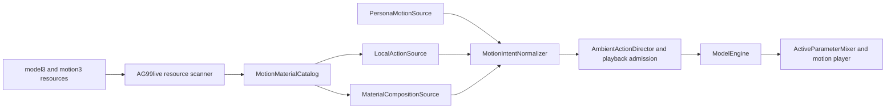

# 动作素材组合与三层动作体系总体计划

> 文档状态 设计与实施计划
> 适用基线 AG99live 1.0.0
> 计划目标 形成可持续扩展的三层动作系统
> 当前状态 资源扫描、参数动作分析、紧凑素材目录同步、第一版 TypeScript 组合器和环境动作准入基线已经落地，自动来源调度尚未实施

## 1. 目标

在现有动作编译和播放链路上建立三个动作来源：

1. 本地动作来源负责高频、低成本的基础生命感和待机表现。
2. 素材组合来源从模型已有动作中提取片段和参数原子，按状态重新组合出新的动作。
3. Persona 或大模型来源负责需要完整语境的正式动作和情绪动作。

三类来源统一进入动作意图归一化、状态准入、ModelEngine 编译和 Live2D 播放链路。每个来源保留独立的来源标识、诊断信息和失败原因。

## 2. 当前代码基线

AG99live 当前已经具备以下基础能力：

- `live2d/scanner/scan.py` 根据模型文件和 `FileReferences.Motions` 扫描动作资源。
- `live2d/scanner/motion_scan.py` 解析参数曲线，计算时长、活动窗口、强度、动作特征和驱动组件。
- `parameter_action_library.v2` 保存参数动作原子和素材来源信息。
- `motion_resource_pool` 保存完整动作的驱动组件和参数域索引。
- `motion/pose_reference.py` 可以把动作组件映射为语义轴参考。
- `BaseActionPreviewPanel.vue` 已经具备动作原子的并行组合和顺序组合预览。
- `ActiveParameterMixer` 已经提供待机、交互、直接计划、口型等参数贡献的优先级。
- `engine.motion_intent.v4` 已经统一参数动作的 1–4 步 `motion_steps`。
- Adapter 会把 `motion_material_catalog.v1` 投影为前端只读素材目录，只增加组合器需要的紧凑索引，不加入完整曲线。
- ModelEngine 目录下已经有纯 TypeScript `composeMaterialMotion`，按配方、Profile 和素材目录生成可复现的 `motion_steps`。

Mk6 当前扫描结果包含 24 个完整动作、578 个驱动组件和 672 个参数动作原子。DeepSeek 当前扫描到 8 个动作和 21 个参数动作原子。这些结果证明素材分析基础已经存在，下一步工作集中在素材组织、组合和调度。

## 3. 总体架构

资源扫描和素材索引在 Adapter 侧完成。运行时组合器和环境动作调度器位于 TypeScript 桌面运行时。AG99 只通过正式的动作或配方选择入口参与语义决策。

## 4. 三类动作的职责

| 来源 | 主要输入 | 主要输出 | 频率和优先级 |
| --- | --- | --- | --- |
| 本地动作 | 当前表现状态、冷却和模型能力 | 单步或短计划参数动作 | 高频、低优先级 |
| 素材组合 | 组合配方、素材库、当前状态 | 1–4 步参数动作 | 中频、低到中优先级 |
| Persona 或大模型 | 用户输入、Persona、对话段和上下文 | 现有动作意图或完整动作资源 | 低频、前景优先级 |

本地动作和素材组合动作共用环境动作调度器。大模型动作继续沿用 Persona 分段和现有 ModelEngine 入口。动作来源属于调度元数据，动作执行仍然由统一的 ModelEngine 负责。

## 5. 预计算和运行时的边界

模型加载或资源变更时预计算以下内容：

- 动作片段和参数原子
- 参数域、语义轴和动作通道映射
- 同一参数和互斥参数的冲突关系
- 组合配方可用性
- 模型源文件哈希和 Profile 身份

运行时只完成以下内容：

- 根据当前状态选择配方
- 从候选素材中选择主体片段和叠加原子
- 执行时长、强度、冷却和随机权重
- 生成动作意图并通过现有校验与编译链路
- 处理打断、过期、冲突和失败收势

系统不枚举全部素材组合。组合空间通过配方、候选池和兼容规则约束，运行时只构造当前场景需要的短计划。

## 6. 关键设计决定

### 6.1 保留动作片段的相关性

一个完整动作中同时驱动头部、身体和视线的参数通常具有时间相关性。组合器应优先使用动作片段作为主体，再叠加少量参数原子。头部、身体、视线和呼吸可以进入第一批组合域，嘴部、口型、眨眼、Physics 和特殊道具参数需要独立所有权。

### 6.2 组合结果优先使用现有协议

第一阶段的组合结果继续生成 `engine.motion_intent.v4` 的 `motion_steps`，避免增加新的 WebSocket 消息形态。完整 `motion_resource_id` 保持独立的资源执行路径。

### 6.3 小模型选择配方和素材

小模型可以选择配方、状态标签或经过验证的素材 ID。组合器负责具体参数、时长、冲突和回中。高频本地表现不等待模型请求。

### 6.4 不恢复旧的整库筛选流程

历史版本的 `base_action_library.v1` 和 `action_llm_filter.py` 主要解决动作原子筛选，并在模型分析阶段触发 Provider 请求。新方案沿用其中的素材组织思路，运行时组合由本地组合器负责。

## 7. 实施阶段

| 阶段 | 目标 | 主要产物 |
| --- | --- | --- |
| 阶段 0 | 锁定扫描基线和候选素材 | 扫描报告、模型能力快照、问题清单 |
| 阶段 1 | 建立素材库 | `MotionFragment`、`MotionAtom`、缓存索引（第一版已落地） |
| 阶段 2 | 建立组合器 | 配方注册表、兼容规则、纯 TypeScript 组合器（第一版已落地） |
| 阶段 3 | 接入环境动作调度 | `AmbientActionDirector` 准入基线已落地，本地动作和组合动作自动来源仍待接入 |
| 阶段 4 | 接入小模型选择 | 配方选择协议、超时和本地回退 |
| 阶段 5 | 提升曲线保真度 | 紧凑曲线素材、片段重放和质量调参 |
| 阶段 6 | 真实模型验收 | 表现、冲突、性能和发布结论 |

阶段按依赖顺序推进。阶段 0 至阶段 3 稳定前，不改变大模型动作协议和 C++ 实现。

## 8. 非目标

- 不在本计划中改造 C++ Runtime。
- 不把截图、桌面观察或输入事件直接转换为动作请求。
- 不让组合器绕过 Semantic Axis Profile 和 ModelEngine。
- 不在模型加载阶段持续调用小模型筛选全部素材。
- 不将所有参数轨道无约束地任意拼接。
- 不把完整曲线素材直接塞入现有普通模型同步字段。

## 9. 完成标准

总体计划完成需要满足以下条件：

- 三类动作来源可以在运行时被区分和追踪。
- 本地动作、组合动作和大模型动作共用同一套准入、编译、播放和终态规则。
- 组合动作在当前 Semantic Axis Profile 下始终可验证。
- 对话播放、口型、眨眼、思考随动和环境动作之间没有重复所有权。
- 模型资源变化可以让素材缓存失效并重新生成。
- 小模型不可用时，本地动作和已缓存的组合动作仍然可用。
- 真实运行验收能够记录动作来源、配方、素材和失败原因。
